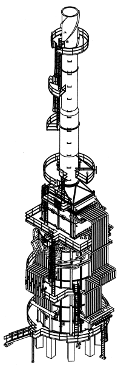
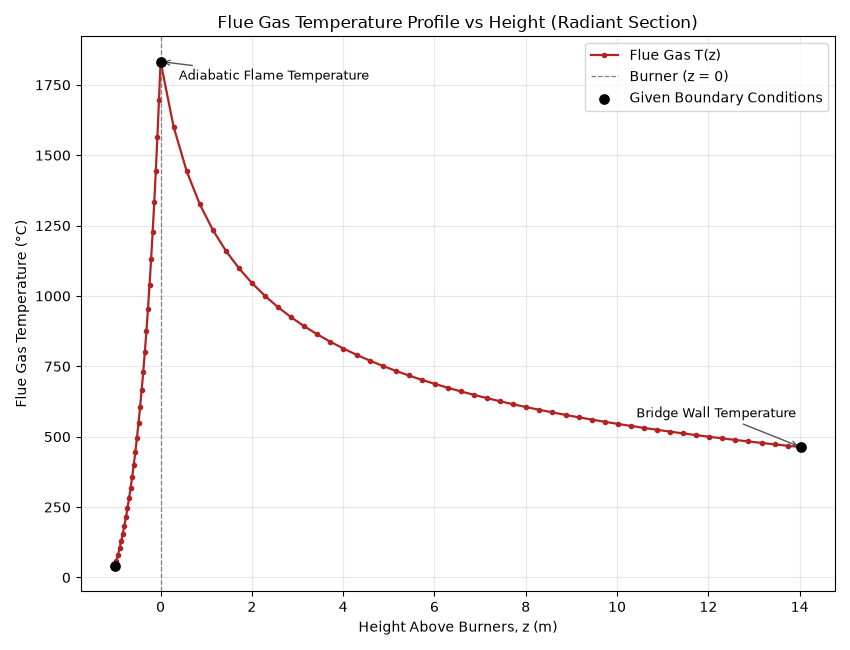
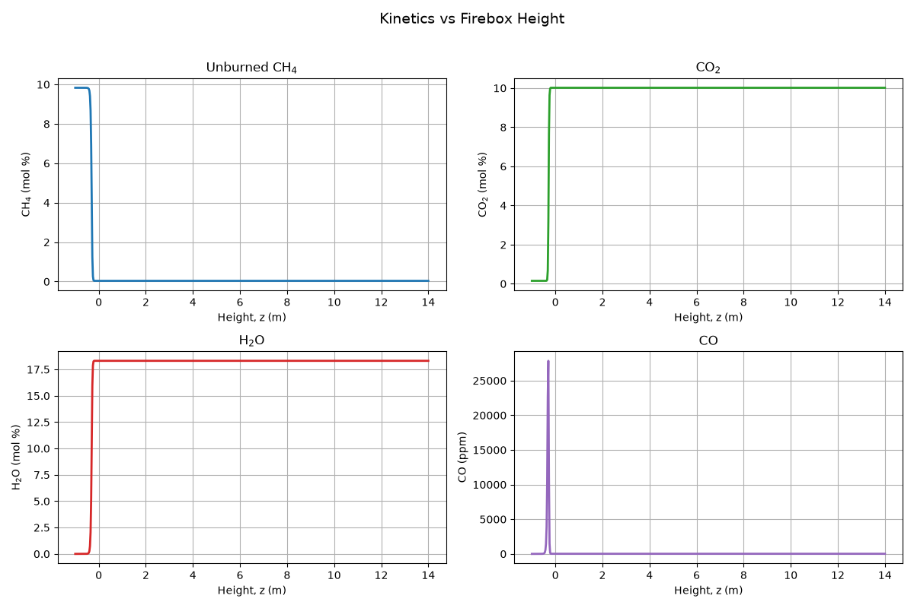
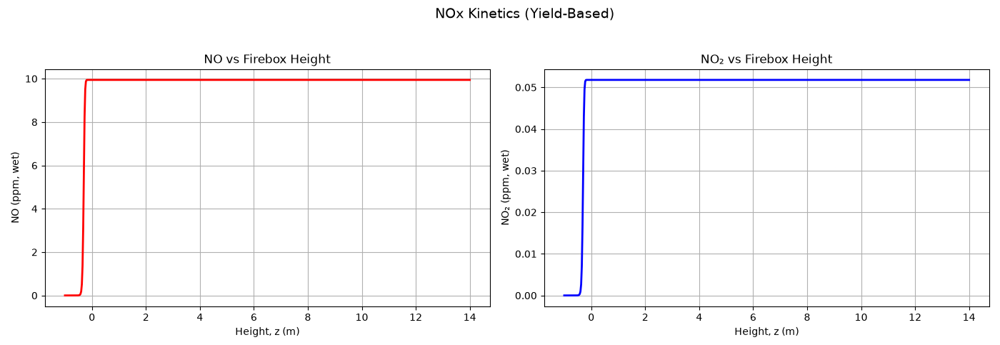

[English](README.md) | [Deutsch](README.de.md) | [Français](README.fr.md)

# Rigorose Modellierung des vertikal-zylindrischen Wärmeträgeröl-Röhrenofens 480-FA-41-01 für die Reboiler des Aminregenerators in der CO₂-Abtrennungsanlage (AGRU) (Zentrale Erdgasaufbereitungsanlage Rhourde Nouss, Südosten Algeriens) – Python

Rigoroses Python-Modell des vertikal-zylindrischen Wärmeträgeröl-Röhrenofens 480-FA-41-01, der die Reboiler des Aminregenerators der CO₂-Abtrennungsanlage (AGRU) in der zentralen Erdgasaufbereitungsanlage Rhourde Nouss im Südosten Algeriens versorgt.

## Übersicht
Das Modell löst die Massen- und Energiebilanzen der Strahlungs- und der Konvektionszone, berechnet die maßgeblichen Flammen- und Ofentemperaturen und koppelt diese mit der Verbrennungs- und NOx-Kinetik. Die berechneten Öl-Austrittstemperaturen wurden mit Anlagendaten aus dem Prozessleitsystem (DCS) verglichen, die berechnete Rauchgaszusammensetzung mit Messwerten eines tragbaren Rauchgasanalysegeräts.

  
   
  <em>Abbildung 1: Schematische Darstellung des Röhrenofens (nicht maßstäblich).</em>

## Modellbeschreibung

### Strahlungszone
- Energie- und Massenbilanzen, gelöst mit der **Lobo-Evans-Methode**.
- Berechnet die **adiabate Flammentemperatur** und die **Feuerbrückentemperatur (Bridge-Wall-Temperatur)** am Austritt der Strahlungszone.

### Konvektionszone
- Energie- und Massenbilanzen, gelöst mit der **NTU-Methode**.
- Berechnet die Öl-Austrittstemperatur der Konvektionszone.

### Verbrennung und Rauchgaskomponenten
- Kinetik-DGL der Brenngasverbrennung mit dem **reduzierten Westbrook-Dryer-Mechanismus** für Methan.
- **Ausbeutebasierte NOx-Kinetik**, kalibriert auf die Messwerte des Rauchgasanalysegeräts.
- Berechnete Rauchgaskomponenten: **CO₂, CO, unverbrannte Kohlenwasserstoffe (CxHy), NO, NO₂ und Gesamt-NOx**.

## Validierung

### Temperaturen: Modell vs. Anlagendaten (DCS)
| Parameter | Modell (°C) | Anlagendaten (°C) | Abweichung (%) |
|---|---|---|---|
| Öl-Austrittstemperatur, Austritt Konvektionszone | 140,80 | 141,0 | 99,86 % |
| Öl-Austrittstemperatur, Austritt Strahlungszone | 142,35 | 142,67 | 99,77 % |
| Rauchgastemperatur an der Feuerbrücke, Austritt Strahlungszone | 463,23 | - | - |

  
   
  <em>Abbildung 2: Temperaturprofil über den Feuerraum (Strahlungszone).</em>

### Rauchgaszusammensetzung: Modell vs. tragbares Rauchgasanalysegerät AMETEK Land Lancom 4

**Hauptkomponenten und unverbrannte Produkte**
| Komponente | Modell (Mol-%) | Analysegerät (Mol-%) | Modell (mg/Nm³) | Analysegerät (mg/Nm³) |
|---|---|---|---|---|
| CO₂ | 12,2617 | 12,4600 | 240.759,29 | 244.652,87 |
| CO | 0,0021 | 0,0021 | 25,67 | 25,62 |
| CxHy | 0,0457 | 0,0433 | 326,91 | 309,09 |

  
   
  <em>Abbildung 3: Gelöstes DGL-System des Westbrook-Dryer-Mechanismus der Methanverbrennung.</em>

**Stickoxide**
| Komponente | Modell (mg/Nm³) | Analysegerät (mg/Nm³) | Verhältnis |
|---|---|---|---|
| NO | 16,2981 | 16,3040 | 99,964 % |
| NO₂ | 0,1301 | 0,1310 | 99,313 % |
| Gesamt-NOx | 16,4283 | 16,4350 | 99,96 % |

  
   
  <em>Abbildung 4: Gelöste Kinetik-DGL der ausbeutebasierten NOx-Bildung.</em>

## Werkzeuge
Python

## Kompetenzen
Röhrenofen-Modellierung - Wärmeübertrager-Modellierung - Modellierung der Wärmestrahlung - Verbrennungskinetik

## Hinweise

Die Eingangsdaten wurden bereinigt; es sind keine vertraulichen Anlagen- oder Herstellerdaten enthalten.

*Dieses Repository ist lediglich eine Vorschau einiger Ergebnisse des in Python entwickelten Modells (es ist kein Code beigefügt).*
