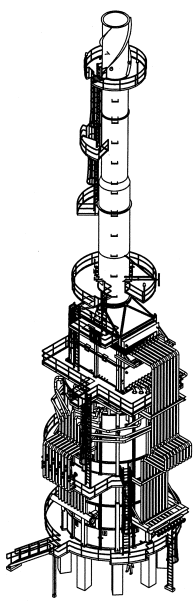
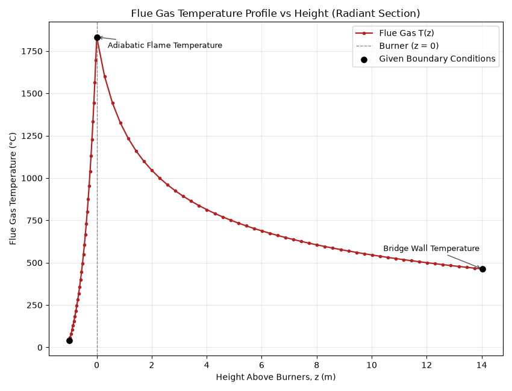
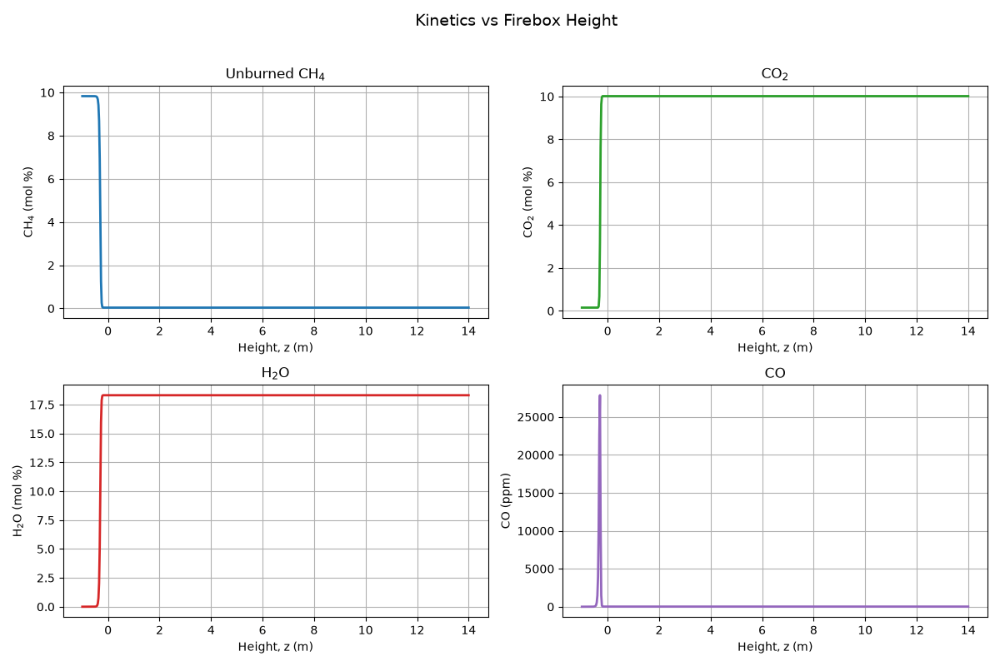
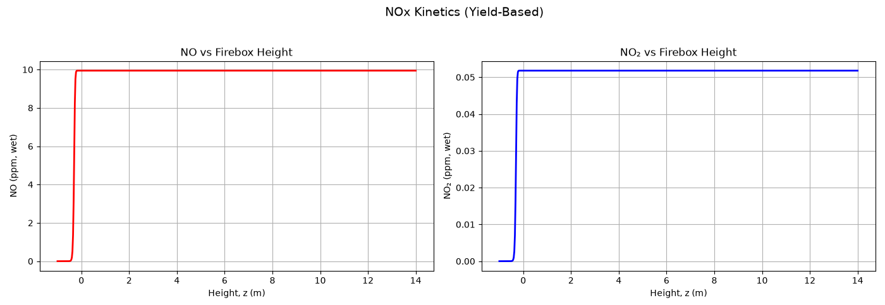

[English](README.md) | [Deutsch](README.de.md) | [Français](README.fr.md)

# Modélisation rigoureuse du four cylindrique vertical de chauffage d'huile caloporteuse 480-FA-41-01 destiné aux rebouilleurs du régénérateur d'amine de l'unité de décarbonatation (AGRU) (installation centrale de traitement du gaz naturel de Rhourde Nouss, Sud-Est de l'Algérie) – Python

Modèle rigoureux en Python du four cylindrique vertical de chauffage d'huile caloporteuse 480-FA-41-01, qui alimente les rebouilleurs du régénérateur d'amine de l'unité de décarbonatation (AGRU) de l'installation centrale de traitement du gaz naturel de Rhourde Nouss, dans le Sud-Est de l'Algérie.

## Aperçu
Le modèle résout les bilans de matière et d'énergie des zones radiante et convective, calcule les principales températures de flamme et de four, et les couple à la cinétique de combustion et de formation des NOx. Les températures de sortie de l'huile calculées ont été comparées aux données de l'installation (SNCC/DCS), et la composition calculée des fumées aux mesures d'un analyseur portable de fumées.

  
   
  <em>Figure 1 : Vue schématique du four (non à l'échelle).</em>

## Description du modèle

### Zone radiante
- Bilans d'énergie et de matière résolus avec la **méthode de Lobo-Evans**.
- Calcule la **température adiabatique de flamme** et la **température de l'autel (bridge wall)** à la sortie de la zone radiante.

### Zone convective
- Bilans d'énergie et de matière résolus avec la **méthode NTU**.
- Calcule la température de sortie de l'huile de la zone convective.

### Combustion et espèces dans les fumées
- EDO de cinétique pour la combustion du gaz combustible (fuel gas) avec le **mécanisme réduit de Westbrook-Dryer** pour le méthane.
- **Cinétique des NOx à base de rendements**, calibrée pour reproduire les mesures de l'analyseur de fumées.
- Espèces calculées dans les fumées : **CO₂, CO, hydrocarbures imbrûlés (CxHy), NO, NO₂ et NOx totaux**.

## Validation

### Températures : modèle vs données de l'installation (SNCC)
| Paramètre | Modèle (°C) | Données de l'installation (°C) | Écart (%) |
|---|---|---|---|
| Température de sortie de l'huile, sortie de la zone convective | 140,80 | 141,0 | 99,86 % |
| Température de sortie de l'huile, sortie de la zone radiante | 142,35 | 142,67 | 99,77 % |
| Température des fumées à l'autel (bridge wall), sortie de la zone radiante | 463,23 | - | - |

  
   
  <em>Figure 2 : Profil de température à travers le foyer (zone radiante).</em>

### Composition des fumées : modèle vs analyseur portable de fumées AMETEK Land Lancom 4

**Espèces majoritaires et produits imbrûlés**
| Espèce | Modèle (% mol) | Analyseur (% mol) | Modèle (mg/Nm³) | Analyseur (mg/Nm³) |
|---|---|---|---|---|
| CO₂ | 12,2617 | 12,4600 | 240 759,29 | 244 652,87 |
| CO | 0,0021 | 0,0021 | 25,67 | 25,62 |
| CxHy | 0,0457 | 0,0433 | 326,91 | 309,09 |

  
   
  <em>Figure 3 : EDO du mécanisme de combustion du méthane de Westbrook-Dryer, résolues.</em>

**Oxydes d'azote**
| Espèce | Modèle (mg/Nm³) | Analyseur (mg/Nm³) | Rapport |
|---|---|---|---|
| NO | 16,2981 | 16,3040 | 99,964 % |
| NO₂ | 0,1301 | 0,1310 | 99,313 % |
| NOx totaux | 16,4283 | 16,4350 | 99,96 % |

  
   
  <em>Figure 4 : EDO de cinétique des NOx à base de rendements, résolues.</em>

## Outils
Python

## Compétences
Modélisation de fours de procédé - Modélisation d'échangeurs de chaleur - Modélisation du rayonnement - Cinétique de combustion

## Remarques

Les données d'entrée ont été assainies ; aucune donnée confidentielle d'usine ou de fournisseur n'est incluse.

*Ce dépôt n'est qu'un aperçu de quelques résultats du modèle développé en Python (aucun code n'est joint).*
