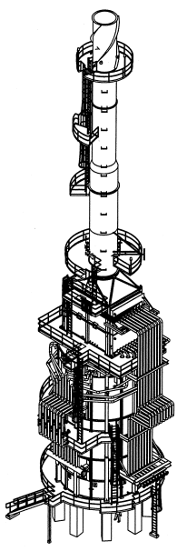
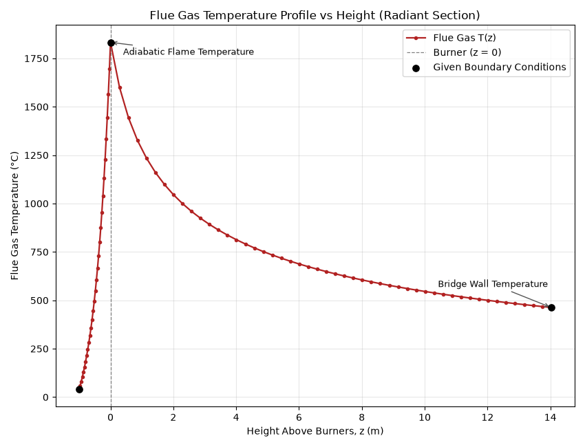
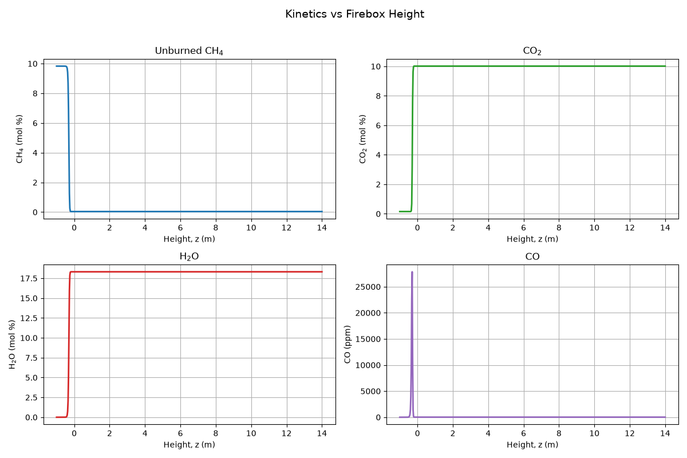
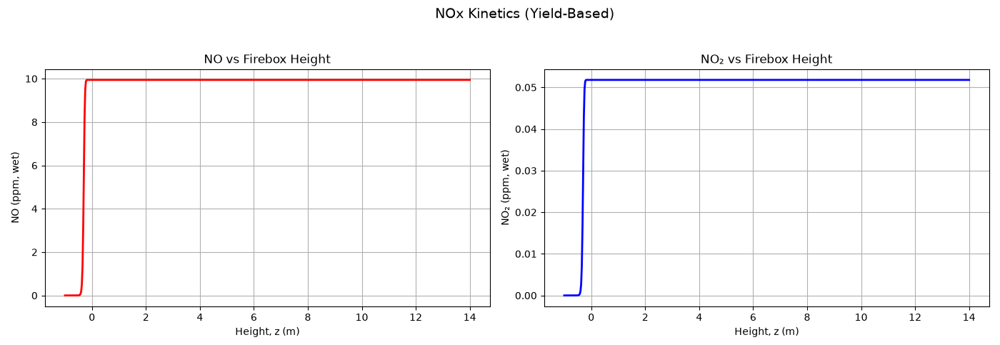

# Rigorous Modeling of the 480-FA-41-01 Vertical Cylindrical Hot Oil Heating Fired Heater Used in the Acid Gas Removal Unit Amine Regenerator Reboilers (Rhourde Nouss Natural Gas Central Processing Facility, Southeastern Algeria) - Python

Rigorous Python model of the vertical cylindrical hot oil heating fired heater 480-FA-41-01, which supplies the amine regenerator reboilers of the Acid Gas Removal Unit (AGRU) at the Rhourde Nouss Natural Gas Central Processing Facility, southeastern Algeria.

## Overview
The model solves the mass and energy balances of the radiant and convective sections, predicts the key flame and furnace temperatures, and couples them with combustion and NOx kinetics. Predicted oil outlet temperatures were compared with plant (DCS) data, and predicted flue gas composition was compared with portable flue gas analyzer measurements.

  
   
  <em>Schematic view of the fired heater (not to scale).</em>

## Model Description

### Radiant Section
- Energy and mass balances solved with the **Lobo-Evans method**.
- Predicts the **Adiabatic Flame Temperature** and the **Bridge Wall Temperature** at the radiant section exit.

### Convective Section
- Energy and mass balances solved with the **NTU method**.
- Predicts the oil outlet temperature from the convective section.

### Combustion and Flue Gas Species
- Kinetics ODEs for fuel gas combustion using the **Westbrook-Dryer reduced mechanism** for methane.
- **Yield-based NOx kinetics**, fine-tuned to match flue gas analyzer measurements.
- Predicted flue gas species: **CO₂, CO, unburned hydrocarbons (CxHy), NO, NO₂ and total NOx**.

## Validation

### Temperatures: Model vs. Plant Data (DCS)
| Parameter | Model (°C) | Plant data (°C) | Deviation (%) |
|---|---|---|---|
| Oil Outlet Temperature, Convective Section Exit | 140.80 | 141.0 | 99.86% |
| Oil Outlet Temperature, Radiant Section Exit| 142.35 | 142.67 | 99.77% |
| Flue Gases Bridge Wall Temperature, Radiant Section Exit | 463.23 | - | - |

  
   
  <em>Figure 1: Temperature Profile Across Firebox (Radiant Section).</em>

### Flue Gas Composition: Model vs. AMETEK Land Lancom 4 Portable Flue Gas Analyzer

**Major species and unburned products**
| Species | Model (mol%) | Analyzer (mol%) | Model (mg/Nm³) | Analyzer (mg/Nm³) |
|---|---|---|---|---|
| CO₂ | 12.2617 | 12.4600 | 240759.29 | 244652.87 |
| CO | 0.0021 | 0.0021 | 25.67 | 25.62 |
| CxHy | 0.0457 | 0.0433 | 326.91 | 309.09 |

  
   
  <em>Figure 2: Westbrook & Dryer Methane Combustion Solved Mechanism ODEs.</em>

**Nitrogen oxides**
| Species | Model (mg/Nm³) | Analyzer (mg/Nm³) | Ratio |
|---|---|---|---|
| NO | 16.2981 |  16.3040 | 99.964%|
| NO₂ | 0.1301 | 0.1310 | 99.313%|
| Total NOx | 16.4283 | 16.4350 | 99.96%|

  
   
  <em>Figure 3: Yield-based NOx Solved kinetics ODEs.</em>

## Tools
Python

## Skills
Fired-Heater Modeling - Heat Exchanger Modeling - Radiation Modeling - Combustion Kinetics

## Notes

Inputs are sanitized; no confidential plant or vendor data is included.

*This repository is only a preview of some results from the model developed in Python (no code is attached).*
